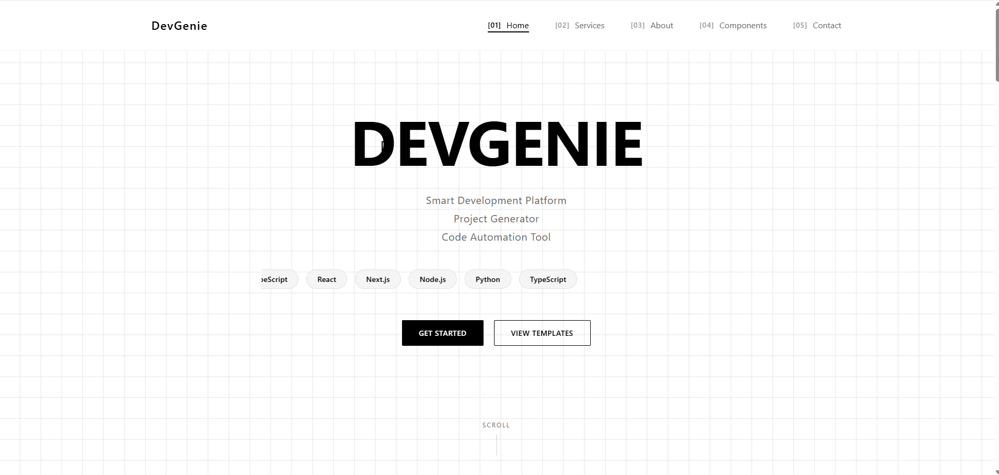
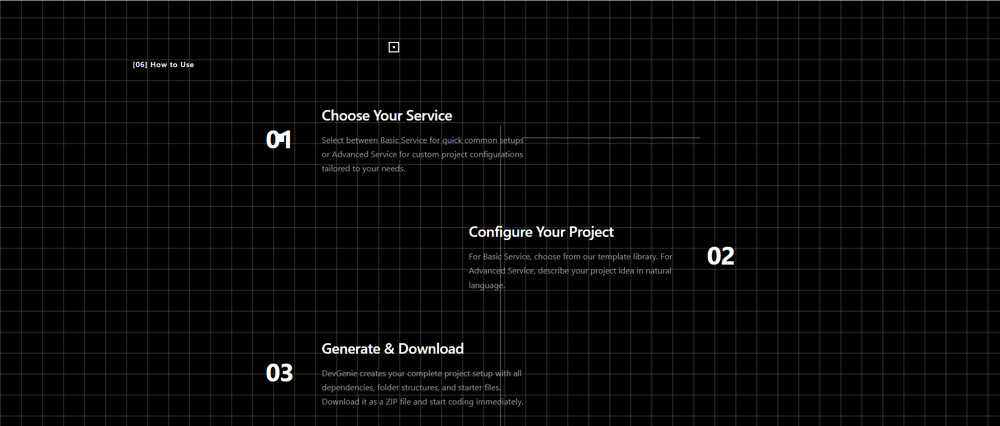
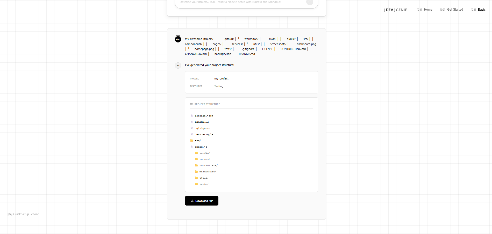

# DevGenie

**Skip the setup. Start building.**

A web-based project scaffolding tool that generates production-ready code structures in seconds.
Describe your stack, configure your architecture, and download a complete project as a ZIP file — no account required.

🔗 **Live:** [https://dev-genie-five.vercel.app](https://dev-genie-five.vercel.app)

---

<div align="center">
  <table>
    <tr>
      <td align="center" width="33%">
        <br/>
        <sub><b>Home — Landing page</b></sub>
      </td>
      <td align="center" width="33%">
        <br/>
        <sub><b>How to Use — Step-by-step guide</b></sub>
      </td>
      <td align="center" width="33%">
        <br/>
        <sub><b>Basic Mode — Project generated & ready to download</b></sub>
      </td>
    </tr>
  </table>
</div>

---

## What is DevGenie?

DevGenie removes the repetitive boilerplate work at the start of every project.
Instead of copying old code or searching for starter templates, you describe what you need and DevGenie builds the entire project structure for you — with real working files, correct dependencies, and ready-to-run code.

---

## How to Use It

### Step 1 — Open the app

Go to [https://dev-genie-five.vercel.app](https://dev-genie-five.vercel.app)

You land on the **Home page**. It explains what DevGenie does and shows two services: Basic and Advanced.

---

[Visit and explore my website]([https://your-website.vercel.app](https://dev-genie-five.vercel.app/))

### Step 2 — Click "Get Started"

You are taken to a **mode selection page** with two options:

**[01] Basic Structure**
For quick setups. You type a plain description and get a project instantly.
Best for: developers who know their stack and want to skip boilerplate.

**[02] Advanced Setup**
For custom configurations. You pick every detail yourself.
Best for: specific architecture requirements or production-level projects.

---

### Step 3A — Using Basic Mode

1. Click **Basic Structure**
2. You see a chat-style input with example prompts to guide you
3. Click an example card or type your own description, for example:
   - *"I want a Node.js setup with Express and MongoDB"*
   - *"Create a React frontend base structure"*
   - *"Setup Django REST API with authentication"*
4. Press **Enter** or click the send button
5. DevGenie shows you a project summary: name, framework, features detected, and file list
6. Click **Download ZIP**
7. Extract the ZIP, run `npm install`, and start coding

---

### Step 3B — Using Advanced Mode

1. Click **Advanced Setup**
2. Fill in the configuration panel:

   | Field | Options |
   |---|---|
   | **Language** | JavaScript, Python, Java, Go |
   | **Framework** | Express, React, Vue, Angular, Django, Flask, FastAPI, Spring Boot, Gin |
   | **Architecture** | MVC, Microservices, Monolith, Clean Architecture |
   | **Features** | Authentication (JWT), Database, Testing, Docker, REST API, Frontend |

3. Describe your project in the text area at the bottom, for example:
   - *"A login and signup system with JWT authentication"*
   - *"REST API for a blog system with posts and comments"*
   - *"CRUD dashboard with React and Express"*
4. Click the send button
5. DevGenie responds with a full project breakdown and generated file list
6. Click **Download ZIP**
7. Extract, run `npm install`, and start building

> You can also click any **Quick Start Example** card at the top to pre-fill the entire form automatically.

---

### Step 3C — Using Templates

1. Click **View Templates** on the home page (or navigate to `/templates`)
2. Browse the template library — search by name or filter by language / type
3. Each card shows: language, framework, architecture, included features, and the original prompt used
4. Two actions per template:
   - **Customize** — opens Advanced Mode with the template pre-loaded so you can tweak it
   - **Download** — generates and downloads the ZIP directly

---

## What Is Included in a Generated Project

Every generated project contains:

```
project-name/
├── package.json          # Dependencies, scripts (start, dev, test)
├── README.md             # Setup and usage instructions
├── .gitignore
├── .env.example          # Environment variable template
└── src/
    ├── index.js          # Entry point with Express server
    ├── config/           # App configuration
    ├── routes/           # API route definitions
    ├── controllers/      # Request handlers
    ├── middleware/        # Error handler, auth middleware
    └── utils/            # Logger and helpers
```

With optional modules enabled:

| Feature | What gets added |
|---|---|
| Authentication | `auth/` routes, JWT controller, bcrypt hashing, User model |
| Database | Mongoose connection, MongoDB User schema |
| Testing | Jest + Supertest, `tests/api.test.js` with sample tests |
| Docker | `Dockerfile` + `docker-compose.yml` |
| Frontend | `client/src/` with React component structure |

---

## Tech Stack

| Layer | Technology |
|---|---|
| UI Framework | React 19 |
| Routing | React Router 7 |
| Icons | React Icons |
| ZIP Generation | JSZip 3.10 |
| File Download | file-saver |
| Backend API | REST API — hosted on Render |
| Deployment | Vercel |
| Build Tool | Create React App |

---

## Run Locally

**Prerequisites:** Node.js v16+, npm v8+

```bash
git clone https://github.com/abrsh21son/Dev-genie.git
cd Dev-genie/client
npm install
npm start
```

Opens at `http://localhost:3000`

```bash
# Production build
npm run build
```

---

## Project Structure

```
Dev-genie/
└── client/
    ├── src/
    │   ├── pages/
    │   │   ├── Home.jsx            # Landing page
    │   │   ├── GetStarted.jsx      # Mode selection
    │   │   ├── ChatBasic.jsx       # Basic generator
    │   │   ├── AdvancedChat.jsx    # Advanced configurator
    │   │   └── Templates.jsx       # Template browser
    │   ├── services/
    │   │   ├── api.js              # Backend API client
    │   │   ├── backendGenerator.js # API calls + offline fallback
    │   │   └── projectGenerator.js # Local JSZip engine
    │   └── App.js                  # Route definitions
    ├── vercel.json                 # SPA routing config
    └── package.json
```

---

## License

AB
